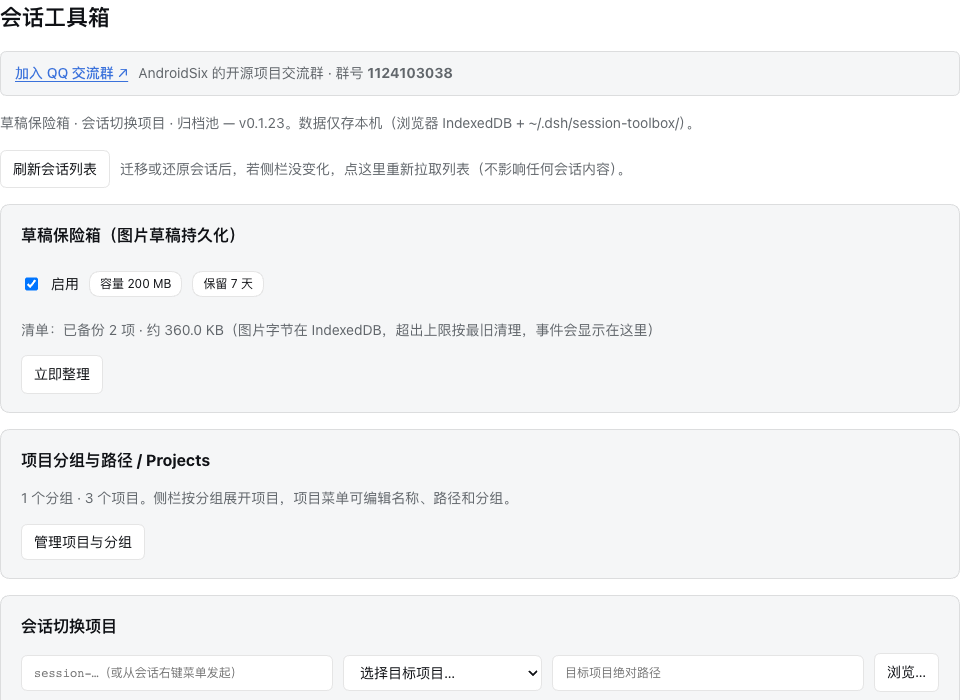
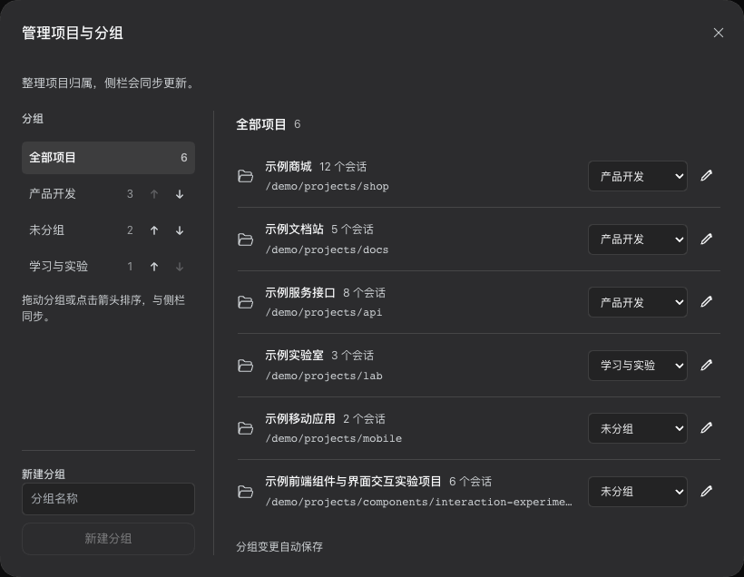
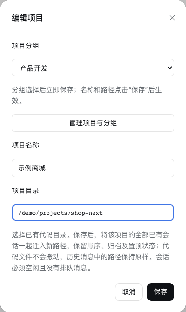
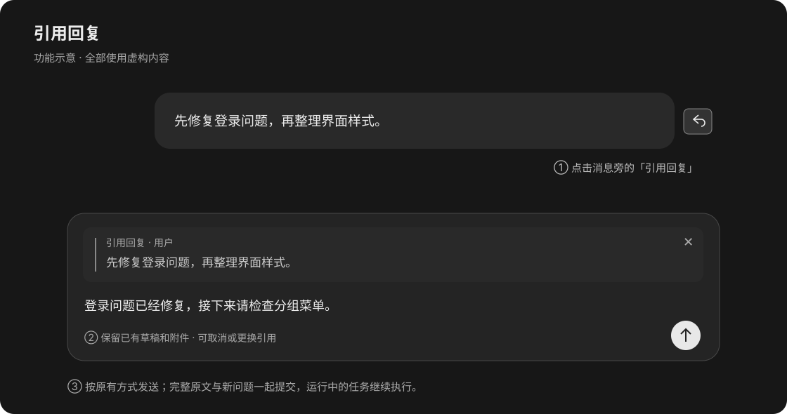
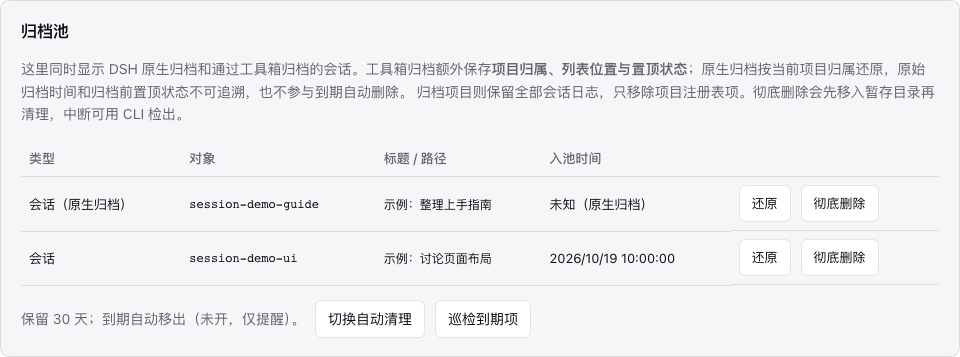
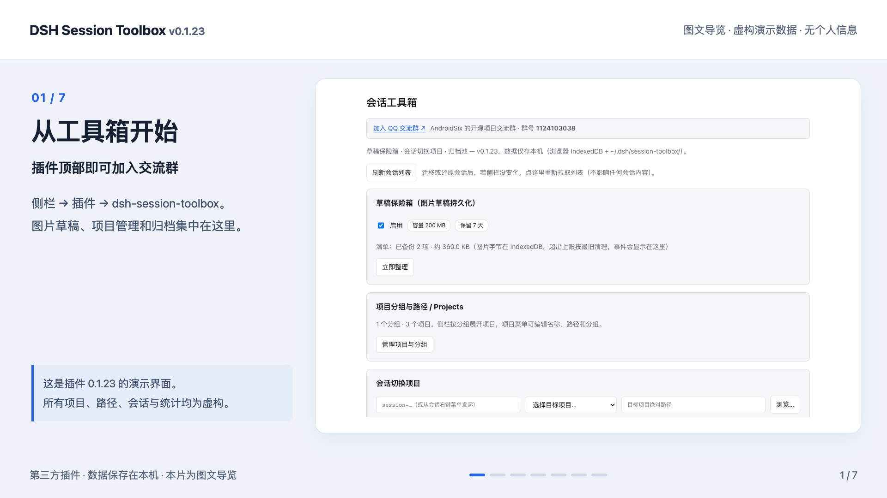

# DSH Session Toolbox

给 DeepSeek Harness（DSH）补上图片草稿备份、会话迁移、归档池、项目分组、引用回复与文件检查点。

第三方插件 · MIT · 不修改 DSH 官方安装包 · 数据保存在本机。

[使用指南](docs/usage.md) · [图文导览视频](docs/media/session-toolbox-tour.mp4) · [更新日志](CHANGELOG.md) · [架构说明](docs/architecture.md)

[加入 QQ 交流群](https://qm.qq.com/q/eQC7OQXQe4) · 群号 **1124103038**。插件页面顶部也有入口。



> 分组管理截图已更新为插件 **0.1.41**，其他既有截图使用 **0.1.23**；DSH 为 **0.2.1-rc.2**。项目、会话、数量及路径均为虚构演示数据。账号、真实侧栏和本机目录未收入素材。视频是带中文说明的图文导览，不是连续操作录屏。

## 能做什么

| 功能 | 用法与结果 |
| --- | --- |
| 图片草稿保险箱 | 备份输入框里尚未发送的图片；切换会话后恢复，发送或删除后清理对应备份，避免旧图反复出现。 |
| 会话切换项目 | 把侧栏会话拖到目标项目标题，或从会话菜单选择目标项目；保留历史消息，完成后刷新列表和数量。 |
| 归档池 | 同时查看 DSH 原生归档与工具箱归档，支持还原；彻底删除需要再次确认。 |
| 项目分组 | 拖动分组标题可调整顺序并自动保存；侧栏按“分组 → 项目 → 会话”显示并可折叠；项目菜单「移入分组…」可直接归组，也可拖到目标分组标题；「编辑项目」可修改分组、名称和路径。 |
| 项目路径编辑 | 修改项目名称与目录，把该项目的全部已有会话迁到新路径，保留顺序、归档、置顶和分组。 |
| 引用回复 | 点击消息旁的引号图标引用整条消息；也可选中正文后右键「引用所选内容」。保留已有草稿及附件，可预览、取消。 |
| 恢复文件检查点 | 点击用户消息旁的回转箭头，先预览再撤销这条消息及之后的文件修改；保留聊天记录，遇到外部修改时拒绝覆盖。 |
| 编辑并重新发送 | 没有记录到可恢复文件修改时显示铅笔图标；文字直接载入原生输入框，可编辑并加截图；原有草稿文字可一键恢复，保留聊天记录。 |
| 后续任务联想 | 每轮结束后生成最多 3 条候选，点击填入输入框，由用户发送；默认开启，可关闭，独立统计 token 用量。 |
| 删除历史消息 | 消息旁点击垃圾桶并确认，从界面及后续 AI 上下文移除这一条。原始日志保留，不撤销文件修改；含工具调用或已经合并进摘要的消息不支持单独删除。 |

**迁移前提：会话空闲且没有待发送的排队消息。** 在已验证的 DSH 0.2.1-rc.2 中，插件会完成该会话的写入和生命周期清理，取得写锁后迁移；已打开过的会话也可立即迁回，无需重启 DSH。宿主清理接口或布局不匹配时会拒绝写入。

## 安装与更新

兼容范围以 [package.json](package.json) 中的 `engines` 为准；当前声明支持 `^0.2.0-rc.2 || ^0.2.1-rc.2`，本机验收基线为 DSH 0.2.1-rc.2。Node 版本要求为 `^22.19.0 || >=24.0.0`。

**已发布版本：0.1.44。** 在 DSH 插件安装页输入 `dsh-session-toolbox` 安装，或使用 [GitHub Release](https://github.com/AndroidSix/dsh-session-toolbox/releases/tag/v0.1.44) 中的本地包。

### 从源码构建本地安装包

```bash
git clone https://github.com/AndroidSix/dsh-session-toolbox.git
cd dsh-session-toolbox
npm ci
npm run check
npm pack --ignore-scripts
```

在 DSH **侧栏 → 插件 → 安装** 中选择生成的 `dsh-session-toolbox-0.1.44.tgz` 并启用。后续版本的文件名随版本号变化。

通过 Plugin Manager 安装、更新或启停，宿主支持 HMR 时可直接生效，无需主动重启 DSH。若安装结果明确报告 `restart-required`，再按提示重启；首次安装后菜单或页面没有出现，也可完全退出后重开一次。不要直接覆盖 DSH 的 `node_modules` 来代替插件管理器更新。

### 通过 npm 安装

在 DSH 插件安装页输入 `dsh-session-toolbox`，安装并启用。

`npm install -g dsh-session-toolbox` 只用于安装命令行工具，不能代替在 DSH 内安装插件。

## 从这里开始

1. 打开 **侧栏 → 插件 → dsh-session-toolbox**，进入工具箱；标题下方可以加入 QQ 交流群。
2. 查看「草稿保险箱」开关。默认保留 7 天、上限 200 MB；在会话中放入一张未发送的示例图片，切走再回来检查恢复。
3. 点击「管理项目与分组」，创建分组并为项目选择归属；回到侧栏展开分组，项目显示在分组下；项目的「… → 编辑项目」可直接修改归属。
4. 需要移动会话时，使用会话菜单「切换到其它项目…」；DSH 原生归档按钮产生的条目也能在工具箱归档池里找到。

分步说明、限制和排错见 [使用指南](docs/usage.md)。

## 项目分组与路径编辑



管理弹窗左侧按分组筛选项目，拖动分组或点击旁边的上移、下移箭头即可调整顺序，与侧栏即时同步并自动保存；右侧可直接修改归属，点项目行的铅笔可编辑名称与路径；长路径悬停可查看全文，窄窗口会切换为单栏。侧栏分组只改变显示范围，原生搜索仍搜索全部会话。每个项目可归入一个分组；删除分组后，其中的项目回到「未分组」。 拖动侧栏分组标题，在目标标题的上半部或下半部松开，按插入线调整前后顺序；聚焦分组标题后也可按 `Alt/Option + ↑/↓` 上下移动。顺序自动保存，组内项目与会话跟随分组移动，刷新和切换会话后仍保留。「未分组」同样可拖动或用箭头排序，其项目整体跟随；旧版数据首次升级保留原顺序。

在管理弹窗点击项目行的铅笔「编辑项目」可同时修改名称和路径。选择的是**已经存在的新代码目录**；保存时迁移全部已有会话，**代码文件本身不会搬动**，历史消息中的旧绝对路径也不会改写。中断后可点击「继续迁移」。



## 引用回复

消息操作栏中的**圆圈引号**支持引用用户消息与助手最终答复。也可选中同一条消息中的一段正文，右键选择「引用所选内容」，菜单保留「复制」。点击后在输入卡片内显示引用预览，并在原生输入框中保留一个引用标记；可继续填写问题，或点「×」取消引用。可连续引用多条消息，每条预览都能单独取消；已有问题、其他引用和附件会保留，引用插入输入框原光标处；没有有效输入位置时放到末尾，插入后可直接接着输入。



引用随该会话的原生草稿保存，刷新或切回会话可以恢复。发送、排队或引导均沿用 DSH 原生行为；发送后引用原文会作为 Markdown 引用与新问题一起交给当前会话的模型。整条引用不复制推理过程、工具结果或图片字节；选区引用只包含你选中的文字。此图为虚构示意，现有视频仍演示 0.1.23 的功能。

## 后续任务联想与独立用量

正常结束后会等待宿主收尾空闲（最多 15 秒），新消息开始即取消等待；不会因收尾超过 150 毫秒而漏掉本轮。生成中、失败及空候选会在对应回答下方显示简短可关闭的状态，模型失败不会自动重试。

问答正常结束后，对应的最后一条回答下方显示最多 3 条后续任务候选，与正文对齐；不固定占用输入区。点击一条即可填入当前会话输入框；已有文字会保留，候选追加在后面，截图和引用保持原样。候选不会自动发送。选择候选、开始输入或点击「收起建议」后，本轮建议收起；同一窗口刷新或切换回来也不再展开，下一轮可显示新建议。

在**插件 → 会话工具箱 → 接下来任务联想**中开关此功能，默认开启。开启后每轮正常结束会额外调用一次该会话所选模型，取最近最多 6 条可见消息文字，输入上限 12 KB、输出上限 600 token；不发送图片、工具输出或思考过程。正在排队的新轮次、子代理、停止或失败的轮次不会触发生成，失败不自动重试；可点击回答末尾引用图标前的星光图标手动生成或重试，生成中防止重复点击，关闭自动联想后也可手动使用。手动调用同样独立统计 token。关闭会取消待处理请求，但已经发出的请求可能已有消耗。重新打开历史会话不会补生成候选。

同一设置区显示本功能独立的调用/成功/失败/取消次数、未缓存输入、缓存读取/写入、输出及总 token，并提供按模型、近 90 天 UTC 日期的统计。以模型服务商报告为准，输出含思考 token，不能重复相加；缺少完整用量或尚未结算的调用单列，已报告总数不包含它们。账本存于 `~/.dsh/session-toolbox/next-task-usage.json`，保留累计统计和最近 200 次请求的用量元数据，不保存候选提示词或聊天正文。已完成候选单独缓存在本机 `next-task-candidates.json`，最多 100 个会话；启动或热更新恢复最近 7 天的结果，不会为恢复额外调用模型。尚未使用的建议切换回来仍可显示，已收起的本轮建议保持收起。

## 恢复文件检查点

在用户消息旁点击**回转箭头 → 恢复检查点**，核对待恢复文件，再确认。恢复范围为这条消息及之后在同一会话中记录到的代码修改，聊天记录保留。插件保存独立的本机文件快照，不修改 Git 提交、暂存区或分支。

没有记录到待恢复文件修改时，该位置显示**铅笔 → 编辑并重新发送**。点击后对应消息的文字直接载入原生会话输入框，可以继续修改、添加截图或文件，再按原生发送按钮发送。保留原消息及后续聊天；若输入框已有文字，可点击「恢复原草稿文字」取回。现有附件保持不变，历史消息的附件不自动复制，请按需重新添加。旧消息缺少文件快照时也可重新发送，但这不代表旧消息从未修改文件。

工具运行期间请避免手动修改同一项目；该时间窗口中的写入无法独立区分来源，可能一起进入检查点。快照完成后的手动修改会在恢复前检测并拦截。

删除历史消息可点击用户消息或助手回复操作栏中的**垃圾桶**。确认后从界面隐藏，并通过 DSH 原生上下文替换使该条消息不再进入后续模型请求。任务运行或有队列消息时需先等待完成；已经合并进摘要的消息拒绝单独删除。此操作不会清除其它消息中引用过的相同内容，不撤销代码修改，也不会擦除原始磁盘日志。删除状态随会话持久化，不提供界面撤销。

检查点从启用后的工具调用开始记录，无法补回旧消息缺失的文件内容。默认保留最近 100 条消息的记录、最长 30 天，单文件上限 8 MiB，单次扫描上限 64 MiB / 10,000 个文件，快照存储上限 256 MiB。仅支持本地项目内的普通文件，排除 Git 忽略文件、环境文件、依赖及构建目录。持续运行的后台终端、不同消息或不同会话在同一项目交叠执行、符号链接和超限项目会显示无法完整恢复的原因；同一消息的并行工具共享一个检查点。手动或其他会话再次修改目标文件时拒绝覆盖。详见[使用指南](docs/usage.md#9-恢复代码修改保留聊天记录)。

## 归档与还原



原生归档会显示「会话（原生归档）」。工具箱归档额外保存项目、顺序和置顶快照；原生归档无法补回过去的归档时间和置顶状态，也不参与插件的到期自动删除。

「还原」让记录回到对应项目；「彻底删除」会删除日志等本地记录，无法通过归档池撤销。默认关闭自动清理。

## 数据与隐私

| 数据 | 保存位置 |
| --- | --- |
| 图片草稿字节 | 当前浏览器的 IndexedDB：`dsh-session-toolbox-vault` |
| 设置、草稿清单、分组、迁移进度、归档账本 | `~/.dsh/session-toolbox/` |
| 会话日志与工作区账本 | DSH 原有数据目录：`~/.dsh/sessions/`、`~/.dsh/storages/workspace.json` |

任务联想开启时会向当前会话的模型服务发送上述有限文字上下文，可在设置中关闭；图片草稿仅在本机备份。本机管理接口校验来源与写入密钥。点击 QQ 或 GitHub 链接会打开对应外部站点。IndexedDB 随浏览器配置隔离，换浏览器或清除站点数据可能使图片备份不可用。

反馈问题时只需附版本、复现步骤和脱敏报错；请勿直接公开完整会话、`status` 输出、凭据文件、写入密钥或带账号与路径的截图。本文公开素材的处理说明见 [素材说明](docs/media/README.md)。

## 视频导览

[](docs/media/session-toolbox-tour.mp4)

[下载 / 播放 MP4](docs/media/session-toolbox-tour.mp4) · [字幕 VTT](docs/media/session-toolbox-tour.vtt)。视频无音轨，中文操作说明已放入画面；覆盖插件入口、分组、路径编辑、会话迁移与归档池（视频基于旧版，队列引导现已交由 DSH 原生提供）。若 Markdown 阅读器不能内嵌播放，可下载后观看。

## 开发与维护

```bash
npm ci
npm run check   # 构建、单元/集成测试、包形态检查
```

测试覆盖截图恢复、原生归档、迁移中断恢复、项目分组、会话拖动切换项目、提示自动消失、整条与选区引用，以及文件检查点的修改/新增/删除/二进制恢复、冲突拦截和恢复中断重试。另有 2 项真实日志只读检查需显式启用。

更多配置、离线 CLI 与实现细节见 [架构说明](docs/architecture.md)，提交约定见 [贡献指南](CONTRIBUTING.md)。

## 反馈与许可

[QQ 交流群](https://qm.qq.com/q/eQC7OQXQe4)（**1124103038**） · [GitHub Issues](https://github.com/AndroidSix/dsh-session-toolbox/issues)

MIT；与 DeepSeek 官方无隶属或背书关系。删除与迁移相关风险见 [免责声明](DISCLAIMER.md)，上游参考与代码来源见 [第三方声明](THIRD_PARTY_NOTICES.md)。工程形态参考同作者的 [dsh-multi-router](https://github.com/AndroidSix/dsh-multi-router)。
