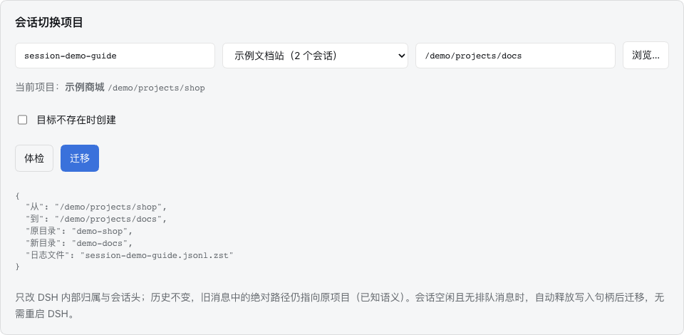

# 使用指南

适用：Session Toolbox 0.1.47（源码版，尚未发布至 npm）；分组管理截图使用 0.1.41，其余既有截图使用 0.1.23，界面截图基于 DSH 0.2.1-rc.2。

[返回首页](../README.md) · [观看图文导览视频](media/session-toolbox-tour.mp4) · [素材脱敏说明](media/README.md)

所有截图中的项目、路径、会话与统计均为虚构演示数据，`/demo/projects/…` 不是应直接填入的本机路径。请在实际使用时选择自己的已有代码目录。

## 1. 打开工具箱

在 DSH 侧栏点击「插件」，再打开 `dsh-session-toolbox` 详情。顶部显示「会话工具箱」、交流群入口、群号和当前版本；下方是草稿保险箱、项目管理、会话迁移与归档池。


如果显示「等待后台数据…」，稍等后台连接完成再操作。若持续显示连接错误，检查插件是否启用、宿主版本是否兼容，以及安装结果是否提示需要重启。

## 2. 恢复未发送的图片草稿

1. 在工具箱确认「草稿保险箱」已启用。
2. 在会话 A 的输入框粘贴、拖入或选择图片，暂不发送。
3. 切到会话 B，再切回 A，图片草稿会恢复。刷新或重开 DSH 后，仍需使用同一浏览器配置。
4. 发送或移除图片后，该图片的对应备份会清理；之后切回来不应再次出现已发送的旧截图。

默认保留 **7 天 / 200 MB**，超限优先清理较旧记录。「立即整理」按当前保留策略清理浏览器备份；关闭功能会保留已有备份。

这项功能用于未发送草稿，不是已发送消息和附件的整库备份。切换浏览器、清空 IndexedDB 或超过保留期限后，无法依靠它恢复旧草稿。

## 3. 创建分组并整理项目

1. 点击侧栏「项目分组」旁的 **…**，或工具箱里的「管理项目与分组」。
2. 填写分组名称，点击「新建分组」。
3. 左侧按分组筛选项目，右侧直接修改项目所属分组；也可选「未分组」，变更自动保存。
4. 左侧可拖动分组行调整顺序，或点击右侧上移、下移箭头；首尾不可移动的方向会禁用。顺序立即同步到实际侧栏并自动保存，「全部项目」作为筛选入口保持固定；「未分组」同样可拖动和用箭头排序。
5. 选中一个分组后，可用右侧标题旁的铅笔重命名、垃圾桶删除分组。删除只解除项目归组关系。
6. 回到侧栏，展开分组，其下是项目和会话；分组标题旁的 **…** 也可管理分组。


原生项目行的「… → 编辑项目」也可修改所属分组。分组选择立即保存，名称和目录在点击「保存」后生效。

拖动侧栏分组标题，在目标标题上半部或下半部松开，插入线表示将放在目标之前或之后；「未分组」也可作为拖动源和目标，插入线同样区分之前、之后。分组折叠时也能排序。顺序自动保存，刷新、切换会话及热更新后仍保留；组内项目和会话跟随分组移动，组内原有顺序不变。「未分组」位置也会保存，删除自定义分组时项目仍回到它；默认分组不能删除或重命名。键盘操作：聚焦分组标题后，按 `Alt/Option + ↑/↓` 上下移动。

项目菜单的「移入分组…」可直接选择目标分组；也可拖动项目行到目标分组标题，包括「未分组」，原有会话随项目一起显示。

分组支持重命名与删除。删除分组只解除归组关系，项目和会话仍保留。原生项目菜单、排序与归档仍可使用；原生搜索覆盖全部会话，不受分组折叠影响。

## 4. 更换项目路径，并迁移已有会话

准备好目标代码目录；插件不会复制或移动源代码文件。需要移动代码时，先自行完成代码目录调整。

1. 打开「管理项目与分组」，找到项目并点击项目行右侧的铅笔「编辑项目」。
2. 可修改「项目名称」；在「项目目录」输入或浏览选择新的**已有目录**。
3. 检查路径后点击「保存」。名称单独变更不迁移日志；路径变更会迁移该项目的**全部已有会话**。
4. 完成后检查项目标题、路径、会话数量，以及原先的分组、置顶和归档状态。


会话历史、排序、归档、置顶与分组会保留。旧消息中的绝对路径仍然指向旧位置；后续工具操作会使用新项目路径。

**保存被拒绝时：** 所有成员都必须空闲且没有待发送的队列消息。已验证的宿主版本可自动完成单会话写入、释放句柄并取得迁移写锁，无需重启 DSH；运行中的任务仍须先完成。

如果出现未完成迁移，在工具箱或管理弹窗点击「继续迁移」。恢复期间暂停新的迁移、归档和分组变更。不要手工删除进度日志来绕过恢复。

## 5. 把单个会话切换到其他项目

将侧栏会话拖到目标项目的标题上，目标高亮后松开即可切换。支持折叠的目标项目，以及不同分组下的项目；同项目内会话拖动仍使用原生排序。会话必须空闲且无排队消息，迁移失败时侧栏会显示原因。拖到分组标题不会迁移会话，请先展开分组并选择具体项目。

也可从侧栏会话菜单点击「切换到其它项目…」，选择目标项目后执行体检并迁移。

也可在工具箱「会话切换项目」中填写会话 ID，选择目标项目，先点击「体检」，通过后点击「迁移」。下图是这个面板入口的示例，未执行真实迁移。



迁移完成会刷新会话列表与项目数量；拖动迁移的成功提示在 4 秒后自动消失，失败提示保留 8 秒，处理中保持显示。若侧栏未变化，点击顶部「刷新会话列表」。迁回原项目同样要求空闲、无排队消息，并取得独占写锁。

如果提示日志刚刚被写入，请先确认该会话已停止运行，避免宿主继续写入。已打开的空闲会话会由插件释放句柄后迁移。CLI 离线路径仍保留最近写入保护；插件不会在未取得写锁时绕过检查。

## 6. 归档、找到条目并还原

可以使用 DSH 会话行上的**原生归档按钮**，也可使用会话菜单里的「归档到归档池」。然后打开工具箱的「归档池」查看。


| 来源 | 显示与恢复方式 | 到期自动删除 |
| --- | --- | --- |
| DSH 原生归档 | 标记为「会话（原生归档）」；按当前项目归属还原。历史归档时间、归档前置顶状态未知。 | 不参与。 |
| 工具箱归档会话 | 保存项目、顺序与置顶快照，供还原使用。 | 仅在开启自动清理后参与。 |
| 工具箱归档项目 | 保留项目快照和会话日志；成员不再在池中重复列出。 | 依工具箱保留策略。 |

点击「还原」后检查原项目。点击「彻底删除」会弹出确认；确认后删除日志等本地记录，不能通过工具箱撤销。默认自动清理关闭，保留天数为 30 天。

原生归档后没看到条目时，先核对当前插件版本，再刷新会话列表；旧版 0.1.13 不包含新版原生归档同步。

## 7. 原生队列引导

DSH 已原生支持队列引导。0.1.34 起插件移除相关快捷按钮与队列样式覆盖，直接使用 DSH 原生入口。

## 8. 引用会话中的消息

1. 在用户消息或助手最终答复的操作栏点击圆圈引号「引用回复」。也可选中同一条消息中的一段正文，右键选择「引用所选内容」。
2. 输入卡片内出现原文预览，输入区保留原生引用标记；已有草稿与附件继续保留，引用插在原输入光标位置，无有效位置时追加到末尾。
3. 填写新问题后正常发送。运行中会话仍遵循 DSH 的排队/引导设置，不会因引用而停止当前任务。
4. 点某条预览右侧「×」只移除该条引用。继续引用会累加，支持整条消息与选中文字混合引用。


引用按会话随原生草稿保存，刷新后可恢复。预览位于原生输入卡片内，带来源标记与独立关闭按钮，每条最多显示两行，引用较多时预览区内部滚动；已发送引用显示为可展开的引用块，完整原文仍保留用于复制与发送。整条引用发送完整文字原文，选区引用只发送选中文字。右键菜单保留「复制」，支持 Escape 关闭、上下方向键选择；输入框、其他页面及跨消息选区保留原有菜单。整条引用不复制推理过程、工具输出或图片字节。只读会话、输入框忙碌或宿主缺少引用序列化能力时，按钮禁用。引用的原文会发给当前模型，行为与手动粘贴原文后提问相同。

## 9. 恢复代码修改，保留聊天记录

没有待恢复文件修改时，用户消息旁显示**铅笔 → 编辑并重新发送**。点击将历史文字载入原生输入框，可编辑并加截图，然后正常发送；保留聊天记录，已有草稿文字可点击「恢复原草稿文字」取回，当前附件保留。历史附件不会自动复制，按需重新添加。

原消息有图片/文件时，请在输入框按需重新添加。启用前或记录过期的消息也可编辑重发，但缺少记录不代表历史上从未修改文件。快照不完整时仍显示恢复入口及原因，不会误判为空。执行中的检查点暂不接受操作。

1. 启用新版插件后继续使用会话。插件在工具执行前后记录项目文件变化，无需提交 Git。
2. 等待项目中的任务和终端结束，点击用户消息旁的回转箭头「恢复检查点」。
3. 检查弹窗列出的文件；确认后撤销这条消息及其后在同一会话中记录的文件修改，保留全部聊天记录。新增文件会删除，被删除文件会还原。
4. 文件被手动或其他会话再次修改时，弹窗列出冲突，恢复按钮禁用；不会自动覆盖。预览后又有新的消息修改时，须重新检查。
5. 恢复中断后，在原消息处重新打开并重试；持久恢复日志使已完成文件不会重复覆盖。未完成恢复前，该项目的新工具调用会被阻止，以免覆盖恢复中的文件。

**适用范围：** 本地项目内的普通文件，包括未提交的文件和二进制内容。Git 忽略文件、`.env` 等环境变量文件、`.git`、依赖/构建/缓存目录和项目外文件不记录。快照存放在 DSH 数据目录的 `session-toolbox/checkpoints/`，文件仅当前用户可读写，保留最近 100 条消息、最长 30 天，在后续工具调用时清理过期记录。单文件上限 8 MiB、单次扫描上限 64 MiB / 10,000 文件，存储上限 256 MiB。

启用前的消息没有历史文件快照，不能追溯恢复。持续后台终端、不同消息/会话在同一项目交叠执行、符号链接/硬链接或超限会使该检查点不可恢复，并显示原因；同一消息的并行工具会合并记录。终端后台进程的后续写入、编辑器未保存内容、外部系统操作和远程文件不属于可恢复范围。检查点不是 Git 历史或整机备份，聊天上下文不会因恢复而倒退。

快照比较工具执行前后的项目文件。**工具运行期间请避免手动修改同一项目**：这一时间窗口内的其他来源写入无法与工具修改独立区分，可能一起进入检查点。已完成快照之后的手动修改会在恢复前检测并拦截。

## 10. 安装热更新与常见问题

**删除历史消息：**点击用户消息或助手回复操作栏的垃圾桶，核对确认弹窗后删除。从界面及后续 AI 上下文中移除这一条，不撤销文件修改；原始日志保留用于完整性校验，不提供界面撤销。其它消息里出现的相同内容不会一起清除。任务运行或有队列时需等待完成；含工具调用或已合并进摘要的消息拒绝单独删除。切换会话、刷新或插件热更新后，删除状态继续生效。

| 现象 | 处理 |
| --- | --- |
| npm 安装后没有恢复检查点或选区引用 | 核对插件详情中的版本，升级至 0.1.44；也可从 GitHub Release 下载本地包并安装。 |
| 更新插件是否要重启 DSH | 用插件管理器更新，HMR 可用时即时生效。安装结果提示 `restart-required` 或首次安装界面未出现时，再完全退出重开。 |
| 点击任务联想提示「未知的操作类型：nextTasks.generate」 | 界面与后台版本不同步。在插件页停用后重新启用本插件，再刷新界面；支持 HMR 时无需重启 DSH。0.1.45 起在操作前校验版本，安装版本一致时请求官方插件管理器重新加载一次，校验后台版本并更新密钥后才发送操作；失败不会继续向旧后台发送。 |
| 插件能热更新，但迁移提示已加载 | 升级至 0.1.23 后，空闲且无排队消息的会话可在线迁移；未知宿主布局仍会安全拒绝。 |
| 目录选择器不可用 | 手动输入本机绝对路径；更换项目路径时，目标必须是已有目录。 |
| 迁移或还原后会话数量没变 | 点击工具箱顶部「刷新会话列表」；若仍异常，保留脱敏报错和版本号反馈。 |
| 出现未完成迁移 | 用「继续迁移」或单会话迁移的「完成 / 回滚」入口处理；不要手工移动日志。 |
| 图片备份丢失 | 核对浏览器配置、保留时间、容量和站点数据是否被清除。 |

## 11. 反馈前脱敏

建议提供 DSH 版本、插件版本、复现步骤、期望结果和实际结果。截图只保留问题区域，移除账号、头像、真实项目名、会话标题、聊天正文、本机路径和敏感附件；报错中的路径也要替换成示例。

不要公开 `.credentials.yaml`、Cookie、Authorization、插件写入密钥、完整会话日志或未检查的 `status` 输出。

[加入 QQ 交流群](https://qm.qq.com/q/eQC7OQXQe4) · **1124103038** · [提交 Issue](https://github.com/AndroidSix/dsh-session-toolbox/issues)

## 12. 后续任务联想与 token 用量

1. 功能默认开启。每轮问答正常完成后，对应最后一条回答下方显示最多 3 条候选，与正文对齐；点击填入当前会话输入框，已有文字后面追加候选，附件和引用保留，不会自动发送。
2. 在**插件 → 会话工具箱 → 接下来任务联想**中关闭；关闭即取消尚在等待或生成的候选，已发出的请求仍可能消耗 token。重新开启不会为旧轮次补调用。
3. 默认跟随该会话的模型，也可在「联想使用的模型」选择独立服务商与模型并保存。仅取最近最多 6 条可见文字，输入不超过 12 KB、输出最多 600 token。不发送图片、工具输出或思考过程，不影响主会话上下文。停止/失败轮次、子代理不生成，失败不自动重试。
4. 在设置区查看独立调用次数、成功/失败/取消、未缓存输入、缓存读写、输出/总 token、按模型及近 90 天 UTC 日期的消耗。思考属于输出，不重复计入总数；缺少完整用量、尚未结算的请求单独标注，不推算为零消耗。
5. 统计仅记录本功能，按服务商实际返回的用量持续保存；刷新、切换会话或热更新不会清零。候选不写入聊天日志，已完成结果单独缓存在本机 `~/.dsh/session-toolbox/next-task-candidates.json`，最多 100 个会话；启动或热更新恢复最近 7 天的结果，不额外调用模型。用量账本只保留元数据，不记录提示词和聊天正文。

6. 尚未使用的建议在切换会话、刷新或热更新后仍可显示。开始输入、选择候选或点击「收起建议」后，本轮建议收起，同一窗口切回不再展开；下一轮可生成新建议。新消息、删除消息或关闭功能会清除相应候选缓存。
7. 没看到建议时，先查看对应最后一条回答的下方、确认设置已开启，再查看独立调用统计。停止或失败的主问答轮次、已经收起的建议不再显示；模型返回空候选或联想生成失败会显示简短状态。升级前已丢失的结果不会补生成收费请求。

### 任务联想没有出现时

新安装及升级后默认开启，显式关闭的设置会保留。仅为启用后新完成的正常问答生成，不补跑安装前的历史消息。宿主结束后仍可能在收尾，插件最多等待 15 秒，期间新消息开始或关闭开关会取消等待；这个等待不会调用模型或增加 token。

对应回答下方会显示生成中、模型失败或本轮没有合适建议的简短状态，可点关闭；开始输入后也会收起。模型失败不自动重试，下一轮正常问答再验证。插件页可查看调用、成功、失败和独立用量，以及最近调用失败的脱敏原因。凭据权限、限流、输出上限和格式错误分别显示类别，不记录原始错误或请求内容。

0.1.42 起兼容模型在有效 JSON 候选前后附带说明、JSON 代码块和常见对象包装（`candidates` / `suggestions` / `nextTasks` / `next_tasks`）。只提取一份明确的字符串数组；空数组表示没有合适建议，损坏、冲突或普通答复仍显示格式失败，不自动追加收费重试。此前失败的轮次不会自动补生成，可在下一轮正常问答验证，也可点击回答末尾的星光图标手动重试。

### 独立联想模型与界面语言（0.1.47）

工具箱顶部的「界面语言」默认跟随 DSH，宿主切换语言后同步更新；也可固定为中文或 English，仅影响插件，不改变 DSH 全局设置。界面语言不会改写候选或聊天内容。

在「后续任务联想」中选择「指定独立模型」，填写服务商 ID 和模型 ID，点击保存。输入框可从宿主提供的目录补全，也允许填写目录未列出的精确 ID；读取目录不会调用生成接口。目录暂不可用时仍可手填。Ollama、llama.cpp 等本地服务需要先以宿主支持的方式接入 DSH，插件不另存 API Key 或端点。

配置保存在 `~/.dsh/session-toolbox/session-toolbox.json`，旧配置无需迁移。示例中的 ID 仅为占位，请替换为 DSH 实际配置的 ID；服务商与模型必须同时填写或同时清空：

```json
{
  "version": 1,
  "language": "auto",
  "nextTasks": {
    "enabled": true,
    "provider": "your-local-provider-id",
    "model": "your-small-model-id"
  }
}
```

`language` 接受 `auto`、`zh`、`en`。省略 `provider/model` 或将两者置为空字符串，即恢复跟随会话。界面保存立即生效；手工修改文件建议重启 DSH。切换模型会取消旧请求和等待、清除旧候选，不额外补生成。自动开关关闭后手动星光仍可使用同一独立模型。

指定模型不可用、凭据异常、限流或请求超时会显示脱敏原因，**不回落到会话模型、不自动重试**。生成请求最长 45 秒；宿主或适配器应遵守取消信号。用量归属按这次实际选用的 DSH 服务商/模型 ID 记录；如果选择的是路由别名，插件不能据此确认其内部最终后端模型，未报告用量也不会被推算为零。

### 手动生成任务联想

回答末尾、引用图标前的小号星光图标可手动生成候选；悬停显示说明，生成中显示旋转状态并禁用重复点击。可为历史正常完成且仍可见的回答生成，也可在失败、候选已收起或空结果后重新生成。已成功生成时再次点击会重新调用模型，提示为“重新生成任务联想”。运行中、有排队消息、子代理及已删除或合并的回答不能生成。

自动开关关闭后仍可手动使用；只读取截至所选回答的 canonical 问答文字，不把后面的问答带入请求。候选显示在所选回答下方，点击填入当前输入框，由用户发送；手动触发会重新展开本轮已收起的建议。每次实际模型调用都计入原有独立 token 统计，失败不自动重试，缓存恢复不收费。每个会话保留最近一次生成的候选，手动选择其他回答会替换此前候选；正常开始新轮次会清除旧候选。
