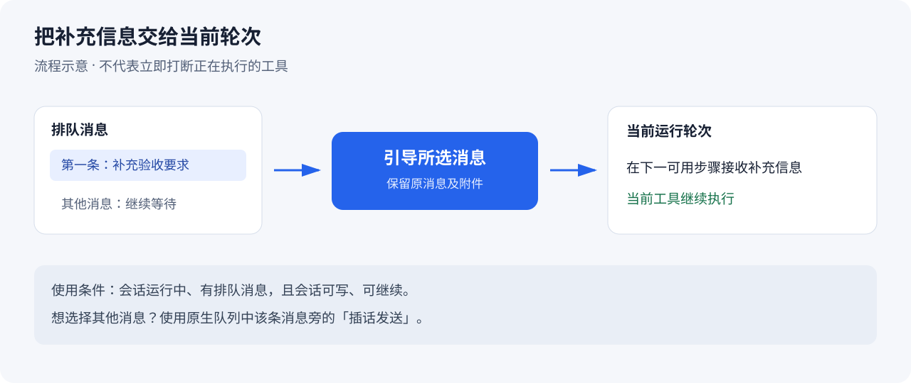

# 使用指南

适用：Session Toolbox 0.1.26；既有截图使用 0.1.23，界面截图基于 DSH 0.2.1-rc.2。

[返回首页](../README.md) · [观看图文导览视频](media/session-toolbox-tour.mp4) · [素材脱敏说明](media/README.md)

所有截图中的项目、路径、会话与统计均为虚构演示数据，`/demo/projects/…` 不是应直接填入的本机路径。请在实际使用时选择自己的已有代码目录。

## 1. 打开工具箱

在 DSH 侧栏点击「插件」，再打开 `dsh-session-toolbox` 详情。顶部显示「会话工具箱」、交流群入口、群号和当前版本；下方是草稿保险箱、项目管理、会话迁移与归档池。

如果显示「等待后台数据…」，稍等后台连接完成再操作。若持续显示连接错误，检查插件是否启用、宿主版本是否兼容，以及安装结果是否提示需要重启。

## 2. 恢复未发送的图片草稿

1. 在工具箱确认「草稿保险箱」已启用。
2. 在会话 A 的输入框粘贴、拖入或选择图片，暂不发送。
3. 切到会话 B，再切回 A，图片草稿会恢复。刷新或重开 DSH 后，仍需使用同一浏览器配置。
4. 发送或移除图片后，该图片的对应备份会清理；之后切回来不应再次出现已发送的旧截图。

默认保留 **7 天 / 200 MB**，超限优先清理较旧记录。「立即整理」按当前保留策略清理浏览器备份；关闭功能会保留已有备份。

这项功能用于未发送草稿，不是已发送消息和附件的整库备份。切换浏览器、清空 IndexedDB 或超过保留期限后，无法依靠它恢复旧草稿。

## 3. 创建分组并整理项目

1. 点击侧栏「项目分组」旁的 **…**，或工具箱里的「管理项目与分组」。
2. 填写分组名称，点击「新建分组」。
3. 在各项目卡片中选择分组；也可选「未分组」。
4. 回到侧栏，展开分组，其下是项目和会话；分组标题旁的 **…** 也可管理分组。

原生项目行的「… → 编辑项目」也可修改所属分组。分组选择立即保存，名称和目录在点击「保存」后生效。

项目菜单的「移入分组…」可直接选择目标分组；也可拖动项目行到目标分组标题，包括「未分组」，原有会话随项目一起显示。

分组支持重命名与删除。删除分组只解除归组关系，项目和会话仍保留。原生项目菜单、排序与归档仍可使用；原生搜索覆盖全部会话，不受分组折叠影响。

## 4. 更换项目路径，并迁移已有会话

准备好目标代码目录；插件不会复制或移动源代码文件。需要移动代码时，先自行完成代码目录调整。

1. 打开「管理项目与分组」，找到项目并点击「编辑项目」。
2. 可修改「项目名称」；在「项目目录」输入或浏览选择新的**已有目录**。
3. 检查路径后点击「保存」。名称单独变更不迁移日志；路径变更会迁移该项目的**全部已有会话**。
4. 完成后检查项目标题、路径、会话数量，以及原先的分组、置顶和归档状态。

会话历史、排序、归档、置顶与分组会保留。旧消息中的绝对路径仍然指向旧位置；后续工具操作会使用新项目路径。

**保存被拒绝时：** 所有成员都必须空闲且没有待发送的队列消息。已验证的宿主版本可自动完成单会话写入、释放句柄并取得迁移写锁，无需重启 DSH；运行中的任务仍须先完成。

如果出现未完成迁移，在工具箱或管理弹窗点击「继续迁移」。恢复期间暂停新的迁移、归档和分组变更。不要手工删除进度日志来绕过恢复。

## 5. 把单个会话切换到其他项目

将侧栏会话拖到目标项目的标题上，目标高亮后松开即可切换。支持折叠的目标项目，以及不同分组下的项目；同项目内会话拖动仍使用原生排序。会话必须空闲且无排队消息，迁移失败时侧栏会显示原因。拖到分组标题不会迁移会话，请先展开分组并选择具体项目。

也可从侧栏会话菜单点击「切换到其它项目…」，选择目标项目后执行体检并迁移。

也可在工具箱「会话切换项目」中填写会话 ID，选择目标项目，先点击「体检」，通过后点击「迁移」。下图是这个面板入口的示例，未执行真实迁移。

迁移完成会刷新会话列表与项目数量；拖动迁移的成功提示在 4 秒后自动消失，失败提示保留 8 秒，处理中保持显示。若侧栏未变化，点击顶部「刷新会话列表」。迁回原项目同样要求空闲、无排队消息，并取得独占写锁。

如果提示日志刚刚被写入，请先确认该会话已停止运行，避免宿主继续写入。已打开的空闲会话会由插件释放句柄后迁移。CLI 离线路径仍保留最近写入保护；插件不会在未取得写锁时绕过检查。

## 6. 归档、找到条目并还原

可以使用 DSH 会话行上的**原生归档按钮**，也可使用会话菜单里的「归档到归档池」。然后打开工具箱的「归档池」查看。

| 来源 | 显示与恢复方式 | 到期自动删除 |
| --- | --- | --- |
| DSH 原生归档 | 标记为「会话（原生归档）」；按当前项目归属还原。历史归档时间、归档前置顶状态未知。 | 不参与。 |
| 工具箱归档会话 | 保存项目、顺序与置顶快照，供还原使用。 | 仅在开启自动清理后参与。 |
| 工具箱归档项目 | 保留项目快照和会话日志；成员不再在池中重复列出。 | 依工具箱保留策略。 |

点击「还原」后检查原项目。点击「彻底删除」会弹出确认；确认后删除日志等本地记录，不能通过工具箱撤销。默认自动清理关闭，保留天数为 30 天。

原生归档后没看到条目时，先核对当前插件版本，再刷新会话列表；旧版 0.1.13 不包含新版原生归档同步。

## 7. 将队列消息引导到当前轮次

1. 在会话运行时发送一条补充消息，使其进入队列。
2. 展开原生消息队列，在要补充的那条消息旁点击「引导」。
3. 选中的队列消息被交给当前轮次，在下一可用步骤接收；当前工具继续执行，其余排队消息继续等待。
4. 输入区「引导下一条」仍可作为快捷入口，作用是选择队列第一条。

引导保留原消息及附件，不会发送停止指令，也不保证让模型立刻改变正在执行的工具。空闲会话、只读会话或不可继续的子会话不能引导；无排队消息时不会显示这个按钮。

上图是流程示意，不是对运行中会话的录屏。

## 8. 引用会话中的消息

1. 在用户消息或助手最终答复的操作栏点击「引用回复」箭头。
2. 输入框上方出现原文预览，输入区保留原生引用标记；已有草稿与附件继续保留。
3. 填写新问题后正常发送。运行中会话仍遵循 DSH 的排队/引导设置，不会因引用而停止当前任务。
4. 点预览右侧「×」只移除引用。再引用另一条消息会替换旧引用。

引用按会话随原生草稿保存，刷新后可恢复。预览最多显示两行，发送包含完整文字原文；不复制推理过程、工具输出或图片字节。只读会话、输入框忙碌或宿主缺少引用序列化能力时，按钮禁用。引用的原文会发给当前模型，行为与手动粘贴原文后提问相同。

## 9. 安装热更新与常见问题

| 现象 | 处理 |
| --- | --- |
| npm 安装后没有分组或路径编辑 | 核对版本：2026-10-19 的 npm 版为 0.1.13，本指南为 0.1.23。按首页步骤构建本地包并安装。 |
| 更新插件是否要重启 DSH | 用插件管理器更新，HMR 可用时即时生效。安装结果提示 `restart-required` 或首次安装界面未出现时，再完全退出重开。 |
| 插件能热更新，但迁移提示已加载 | 升级至 0.1.23 后，空闲且无排队消息的会话可在线迁移；未知宿主布局仍会安全拒绝。 |
| 目录选择器不可用 | 手动输入本机绝对路径；更换项目路径时，目标必须是已有目录。 |
| 迁移或还原后会话数量没变 | 点击工具箱顶部「刷新会话列表」；若仍异常，保留脱敏报错和版本号反馈。 |
| 出现未完成迁移 | 用「继续迁移」或单会话迁移的「完成 / 回滚」入口处理；不要手工移动日志。 |
| 图片备份丢失 | 核对浏览器配置、保留时间、容量和站点数据是否被清除。 |

## 9. 反馈前脱敏

建议提供 DSH 版本、插件版本、复现步骤、期望结果和实际结果。截图只保留问题区域，移除账号、头像、真实项目名、会话标题、聊天正文、本机路径和敏感附件；报错中的路径也要替换成示例。

不要公开 `.credentials.yaml`、Cookie、Authorization、插件写入密钥、完整会话日志或未检查的 `status` 输出。

[加入 QQ 交流群](https://qm.qq.com/q/eQC7OQXQe4) · **1124103038** · [提交 Issue](https://github.com/AndroidSix/dsh-session-toolbox/issues)
